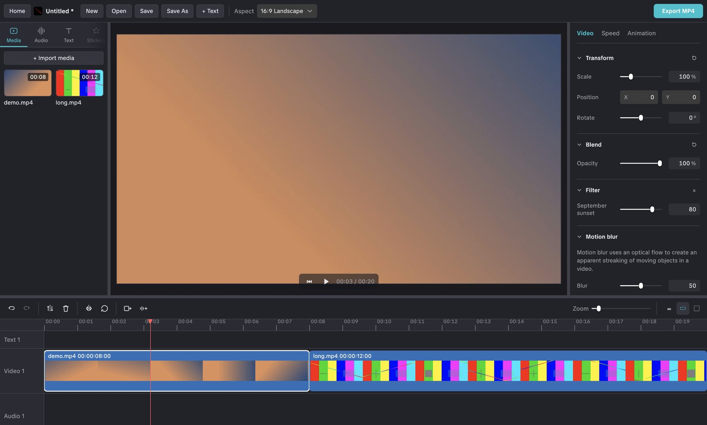

<p align="center">
  
</p>

<h1 align="center">anycut</h1>

<p align="center">
  A free, open-source desktop video editor inspired by CapCut.<br />
  No account, no watermark, no subscription. Everything runs on your computer.
</p>

<p align="center">
  <a href="https://github.com/Kngq/anycut/releases/latest"><b>Download the latest release</b></a>
</p>



## Download

| Platform | Installer |
| --- | --- |
| macOS (Apple Silicon: M1 and later) | [anycut-mac-arm64.dmg](https://github.com/Kngq/anycut/releases/latest/download/anycut-mac-arm64.dmg) |
| macOS (Intel) | [anycut-mac-x64.dmg](https://github.com/Kngq/anycut/releases/latest/download/anycut-mac-x64.dmg) |
| Windows 10/11 (64-bit) | [anycut-windows-setup.exe](https://github.com/Kngq/anycut/releases/latest/download/anycut-windows-setup.exe) |
| Linux (x86-64) | [anycut-linux-x86_64.AppImage](https://github.com/Kngq/anycut/releases/latest/download/anycut-linux-x86_64.AppImage) |

### First launch

The builds aren't signed with a paid Apple or Microsoft certificate yet, so your OS will ask once before opening anycut.

- **macOS:** open the `.dmg` and drag **anycut** into **Applications**. The first time, right-click anycut → **Open** → **Open**. On macOS 15 and later, if there's no Open button: try to open it once, then go to **System Settings → Privacy & Security** and click **Open Anyway**. If macOS says the app "is damaged", run this once in Terminal:
  ```sh
  xattr -cr /Applications/anycut.app
  ```
- **Windows:** run the installer. If SmartScreen shows "Windows protected your PC", click **More info → Run anyway**. anycut installs for your user and adds a Start menu entry.
- **Linux:** make the AppImage executable and run it:
  ```sh
  chmod +x anycut-linux-x86_64.AppImage && ./anycut-linux-x86_64.AppImage
  ```
  Some distros need `libfuse2` for AppImages (`sudo apt install libfuse2`).

## Features

- **Timeline editing:** multi-track video, audio and text; split, trim, copy/paste, group, compound clips, undo/redo.
- **Speed:** constant speed, speed curves with presets (Montage, Hero, Bullet, Jump cut, Flash in/out), reverse, freeze frame, and an option to change the audio pitch with the speed.
- **Look:** 15 colour filters with an intensity slider, effects (blur, shake, zoom, vignette, grain and more), transitions, crop, rotate, flip.
- **Motion:** In / Out / Combo animations (zoom, slide, pop, shake, pulse…), keyframed position, scale and opacity, and optical-flow motion blur.
- **Text and captions:** styled text, plus automatic captions transcribed on your machine (Whisper).
- **Background removal:** on-device person/subject cut-out. No uploads.
- **Media handling:** HDR footage is tone-mapped to SDR; preview proxies for heavy codecs (ProRes etc.); missing-media relinking; content-keyed cache you can clean from the app.
- **Export:** H.264 MP4 rendered by ffmpeg, at the project's resolution and frame rate.

The ML models used by captions and background removal are downloaded the first time you use those features and then work offline.

## Build from source

Requires [Node.js](https://nodejs.org) 22 or later.

```sh
git clone https://github.com/Kngq/anycut.git
cd anycut
npm install
npm run dev        # run the editor with hot reload
npm run dist       # build an installer for your OS into release/
```

Other scripts:

```sh
npm test                 # unit tests (vitest)
npm run test:export      # export smoke test through the real ffmpeg
npx tsc -p tsconfig.json --noEmit   # typecheck
```

## Publishing a release

Releases are built by GitHub Actions (`.github/workflows/release.yml`) on macOS, Windows and Linux, and attached to a GitHub Release with the file names above, so the download links always point at the newest version.

```sh
npm version patch      # bumps the version and creates a tag such as v0.1.1
git push --follow-tags # the tag starts the release build
```

You can also start it from the repository's **Actions** tab → **Release** → **Run workflow**.

## Project layout

| Path | What's there |
| --- | --- |
| `electron/main/` | Electron main process: media probing, proxies, thumbnails, export, captions, background removal, cache |
| `electron/preload/` | The `window.api` bridge between the editor and the main process |
| `src/renderer/` | The editor UI (React): timeline, preview, inspector, panels |
| `src/shared/` | Logic shared by preview and export: the project model, ffmpeg filter graph, effects, filters, animations, speed curves |
| `scripts/` | Export smoke tests and the dev driver used for automated UI testing |

## Notes

anycut is an independent project. It is not affiliated with, endorsed by, or connected to CapCut or ByteDance, and it ships no CapCut code or assets. Its filters, effects and animations are its own implementations.
